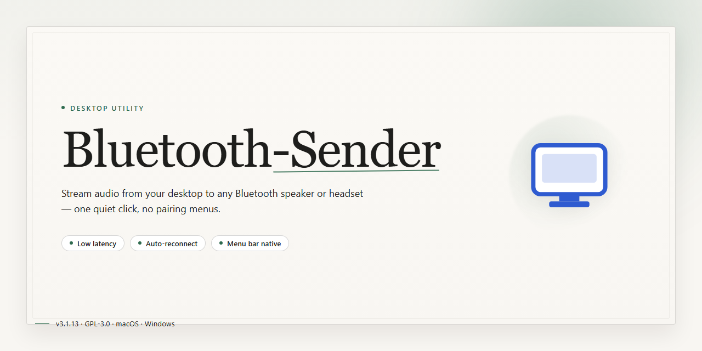

# Bluetooth Sender: High-Range Multimedia File Transfer for Windows 11

### 💻 PowerShell Installer

   

---

Bluetooth Sender is a Windows file management utility that enables direct multimedia transfers from a PC to Bluetooth-enabled smartphones without requiring companion software on the receiving device. It supports multi-file selection and contact-based recipient targeting, with transfers operating reliably at ranges of up to 150 meters. The application provides a streamlined interface for sending images, music, and video content over standard Bluetooth connectivity. Designed for both personal and professional use, it combines broad device compatibility with high-speed transfer capabilities for large files.

## ✅ Requirements

- **OS:** Windows 10 / 11
- **Shell:** PowerShell 5.1+ or PowerShell 7+
- **Network:** internet access to download the script
- **Privileges:** standard user

## Features

- **Bluetooth-based multimedia transfer:** Send images, audio, video, and other multimedia files directly from a Windows PC to Bluetooth-enabled smartphones without intermediate cloud services or account setup.
- **Extended-range connectivity:** Establish and maintain connections over Bluetooth at distances of up to 150 meters, enabling transfers across rooms or between floors without physical repositioning of devices.
- **Multi-device pairing:** Detect and connect to multiple Bluetooth-enabled devices, allowing files to be dispatched to several recipients in sequence from a single session.
- **Contact-list recipient selection:** Choose target devices directly from the integrated contact list, reducing manual device discovery and pairing overhead during routine transfers.
- **Multi-file batch selection:** Queue and send multiple files in a single operation, minimizing repetitive selection steps for large media sets.
- **Receiver-side zero install:** Deliver files to the receiving smartphone without requiring any companion app or additional software on the target device; native Bluetooth support is sufficient.
- **High-throughput transfer engine:** Optimized data channel handling for large files, sustaining transfer rates suitable for video and high-resolution image payloads.
- **Native Windows interface:** Lightweight desktop UI with straightforward file browsing, device selection, and transfer status indicators, designed for minimal resource consumption.
- **Secure local transfers:** Peer-to-peer Bluetooth communication that keeps files off external servers, limiting exposure to third-party infrastructure.
- **Broad device compatibility:** Works with any Bluetooth-capable smartphone or tablet, independent of operating system, provided the device supports standard Bluetooth file transfer profiles.
- **Transfer monitoring and logs:** Real-time progress feedback for active transfers, with completion status per file for verification of delivered content.
- **Configurable device discovery:** Adjustable scan and pairing behavior to manage visible devices and streamline reconnection to previously used hardware.

## How it works

Bluetooth Sender operates as a lightweight desktop application that layers a structured file-management workflow over the native Bluetooth stack of the host Windows system. On launch, the application initializes the local Bluetooth radio, enumerates discoverable and paired devices, and builds a live device registry that is presented in the main interface alongside a file browser pane.

File selection is handled through the built-in manager, which exposes the local filesystem in a tree-and-list layout with filtering by file type. Users can stage individual files or batch-select multiple items; each selection is queued in a transfer list where entries can be reordered or removed before dispatch. The application reads file metadata — name, size, and MIME type — to validate that each item is supported for outbound transfer and to estimate transmission time.

Device pairing follows the standard Bluetooth discovery and bonding sequence. The application scans for nearby radios, lists them with their friendly names and signal indicators, and initiates pairing on user request. Once a target device is bonded, it is persisted in the device registry so subsequent sessions can skip discovery and connect directly. The interface surfaces connection state per device, distinguishing between available, connected, and busy endpoints.

Transfer execution runs as a managed background job. The application negotiates an OBEX object push session with the selected recipient, streams the queued files sequentially, and reports per-file progress, throughput, and completion status in the transfer panel. Failed or interrupted items are retained in the queue for retry without requiring re-selection. For range-sensitive deployments, the application monitors link quality and surfaces signal strength so users can reposition devices to maintain a stable connection across the supported distance.

All operations are driven from a single window: device registry on one side, file manager on the other, and a transfer queue spanning the lower panel. No companion software is required on the receiving handset — the application relies on the recipient device's native Bluetooth object exchange support, keeping the workflow contained to the desktop side.

## Compatibility

Bluetooth Sender is engineered to operate across the broadest practical range of Windows environments and Bluetooth-enabled receiving devices. The sections below detail supported platforms, hardware requirements, and interoperability guarantees.

### Operating System Support

- **Windows 10 (64-bit)** — full support, including version 21H2 and later.
- **Windows 11 (64-bit)** — full support, including all feature updates.
- **Windows 8.1 (64-bit)** — supported with limited functionality; certain UI components may render differently.
- Legacy 32-bit Windows installations are not supported.

### Bluetooth Stack Requirements

- Bluetooth 4.0 or higher on the host machine is required for full transfer speeds.
- Bluetooth 5.0 and later are recommended for optimal throughput and extended range.
- The host adapter must expose a standard Windows Bluetooth stack; vendor-specific or proprietary stacks may require updated drivers.
- Both Classic Bluetooth (RFCOMM/OBEX) and Bluetooth Low Energy discovery are handled natively by the application.

### Receiving Device Compatibility

- Any smartphone, tablet, or Bluetooth-enabled device that supports the OBEX Object Push profile can receive files.
- No companion application, agent, or installation is required on the receiving device.
- Android, iOS, and feature-phone platforms are supported where the native Bluetooth file-receiving service is enabled.
- Transfer range of up to 150 meters is achievable with compatible Class 1 adapters on both ends; actual range depends on hardware class, obstructions, and interference.

### File Type and Size Handling

- Multimedia files including images, audio, video, documents, and archives are supported.
- Individual file size is bounded only by the receiving device's storage and its OBEX implementation limits.
- Multi-file batch transfers are supported; file counts and total payload size scale with available device memory.

### Hardware Baseline

- Processor: 1 GHz or faster.
- Memory: 4 GB RAM or more.
- Storage: sufficient free space for the application and any queued transfer staging.
- A functioning Bluetooth adapter with current drivers installed.

### Interoperability Notes

- Devices must be paired or discoverable prior to initiating a transfer.
- Simultaneous connections to multiple receiving devices are supported, subject to adapter capacity.
- Firewall and security software configurations on the host may affect discovery; standard Bluetooth ports must remain unblocked.
- Compatibility with the latest Bluetooth devices and protocol revisions is maintained through regular application updates.

## FAQ

**What file types does Bluetooth Sender support?**

Bluetooth Sender handles the full range of multimedia content — images, audio, video, documents, and archives — using standard Bluetooth object exchange profiles. Files are transmitted in their native format without transcoding, so quality and metadata remain intact on the receiving device.

**How does the 150-meter transfer range work?**

The extended range is achieved through Bluetooth Class 1 radio support combined with adaptive power management. Actual throughput and range depend on the Bluetooth class of the receiving device, physical obstructions, and radio interference. For optimal performance, keep both devices in direct line of sight and avoid congested 2.4 GHz environments.

**Is any client software required on the receiving smartphone?**

No. Bluetooth Sender relies on the native Bluetooth stack present on all modern smartphones and tablets. The receiving device simply accepts the incoming transfer through its built-in Bluetooth file reception, keeping the workflow zero-install on the mobile side.

**Can I queue multiple files or entire folders in a single session?**

Yes. The multi-file selection engine allows batch queuing of mixed content types, with sequential transfer handling and per-file status tracking. Large payloads are chunked automatically, and interrupted transfers can be resumed without restarting the queue.

**What are the minimum system requirements?**

Bluetooth Sender runs on Windows 10 or later, requires a 1 GHz or faster processor, 4 GB of RAM, and a Bluetooth 4.0 or higher adapter. A Class 1 adapter is recommended to take full advantage of the extended range capability.

**How are transfers secured?**

Pairing and authentication follow the standard Bluetooth security model, including SSP (Secure Simple Pairing) where supported by both endpoints. Data is encrypted over the air using the link-layer encryption negotiated during pairing, and no files are routed through external servers.

**Does Bluetooth Sender work with devices that are already paired to the PC?**

Yes. Previously paired devices appear in the contact and device list and can be selected immediately. For new devices, a standard pairing handshake is performed once; subsequent sessions reconnect automatically when the device is in range and discoverable.

**What happens if a transfer is interrupted?**

Incomplete transfers are flagged in the session log, and the affected files can be re-queued individually. The application verifies file integrity on completion and reports any checksum mismatches so partial or corrupted payloads are never silently accepted.

**Can transfers run in the background while other work continues?**

Yes. Bluetooth Sender operates as a background service with a system tray presence, allowing file queues to progress while you continue using the PC. Transfer progress, completion notifications, and error states are surfaced through tray alerts.

**How do I troubleshoot a device that isn't detected?**

Verify that the target device has Bluetooth enabled and is set to discoverable, confirm the PC adapter drivers are current, and check that no other application holds an exclusive connection to the adapter. Restarting the Bluetooth service and re-scanning typically resolves discovery conflicts.

## Disclaimer

Bluetooth Sender is provided on an "as is" basis, without warranties of any kind, whether express, implied, or statutory, including but not limited to warranties of merchantability, fitness for a particular purpose, and non-infringement. The software is intended as a utility for transferring multimedia files between a Windows desktop and Bluetooth-enabled devices within the operational range supported by the local Bluetooth stack.

Transfer performance, including throughput and effective range, depends on hardware capabilities, Bluetooth adapter class, driver implementation, environmental interference, and the receiving device's profile support. The stated range of up to 150 meters reflects ideal line-of-sight conditions and is not guaranteed in all deployments. Users are responsible for ensuring that both the host system and the target device expose compatible Bluetooth profiles and that pairing and discovery settings permit the intended transfer.

Bluetooth Sender does not modify, intercept, or retain transferred content beyond the scope required to complete an active session. All file selections, recipient choices, and transmission operations are initiated and controlled locally by the user. The software does not provide, and should not be relied upon for, encryption beyond that offered natively by the operating system's Bluetooth stack; users handling sensitive material should verify the security characteristics of their environment before initiating transfers.

Compatibility is limited to the operating system versions and Bluetooth specifications documented in the Compatibility section. Functionality may be affected by third-party drivers, system policy restrictions, or device-specific limitations outside the software's control. No guarantee is made regarding interoperability with every Bluetooth-enabled device on the market.

To the maximum extent permitted by applicable law, the authors and distributors of Bluetooth Sender accept no liability for any direct, indirect, incidental, special, consequential, or punitive damages arising from the use of or inability to use the software, including but not limited to data loss, transmission failure, or corruption of files during transfer. Users assume full responsibility for the selection of files, recipients, and destinations involved in any transfer operation.

Bluetooth Sender is not affiliated with, endorsed by, or sponsored by any device manufacturer or operating system vendor. All product names, trademarks, and registered trademarks referenced in the project materials remain the property of their respective owners. Use of the software constitutes acceptance of this disclaimer.

## License

Bluetooth Sender is distributed as a complete, unrestricted build: every feature described in this document — multi-file selection, contact-list addressing, long-range device discovery, and high-speed multimedia transfer — is available without a paid tier, feature gating, or time-limited evaluation. No license key, activation step, or online entitlement check is required to unlock functionality.

The software is licensed for installation and use on Windows systems meeting the stated compatibility requirements. The license grants perpetual use of the current build and does not expire. Updates issued for the product are delivered under the same terms, so fixes and performance improvements do not introduce new restrictions on previously available capabilities.

Redistribution of the installer is permitted only in its original, unmodified form and only when accompanied by this documentation. The license does not extend to repackaging, bundling with unrelated software, or altering the transfer engine, discovery range, or file-handling routines. Reverse engineering, decompilation, and modification of the compiled binaries are outside the scope of the grant.

Bluetooth Sender operates entirely over local Bluetooth connectivity between the host PC and the receiving device. No account registration is required, and file transfers are not routed through intermediary infrastructure. The license therefore places no conditions on the content transferred; responsibility for the files sent, and for ensuring the receiving device is authorized to accept them, rests with the operator.

The software is provided as-is, without warranty of any kind, express or implied, including but not limited to warranties of merchantability, fitness for a particular purpose, and non-infringement. In no event shall the authors or distributors be liable for any claim, damages, or other liability arising from the use of the software or the transfer of files performed with it. Compatibility depends on the Bluetooth stack and hardware present on both endpoints; performance within the advertised 150-meter range varies with environmental conditions and device class.

Use of Bluetooth Sender constitutes acceptance of these terms.